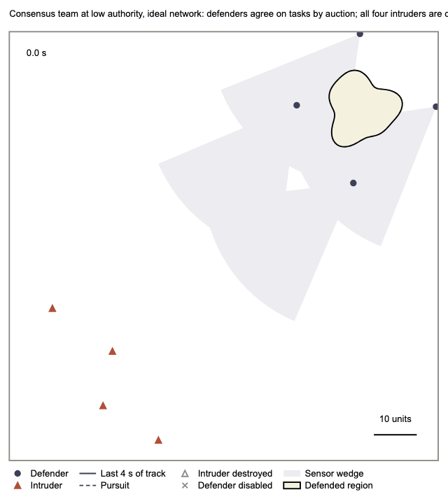
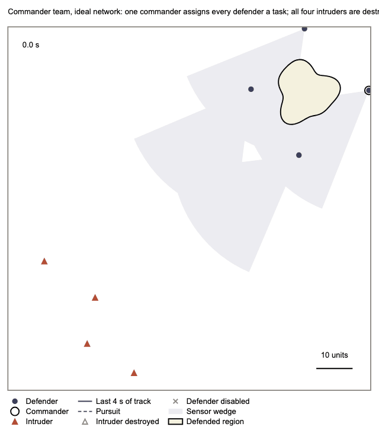
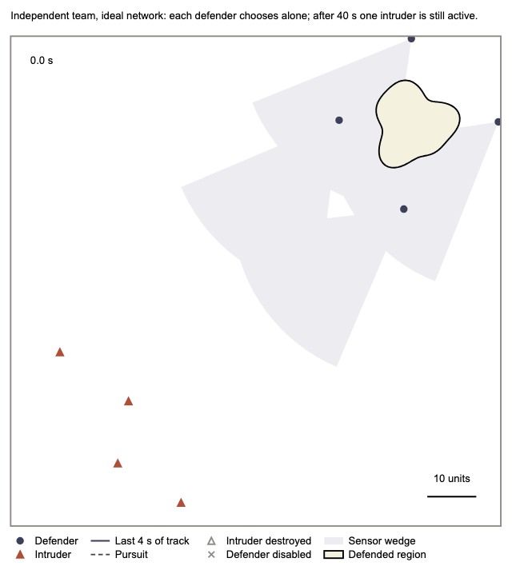
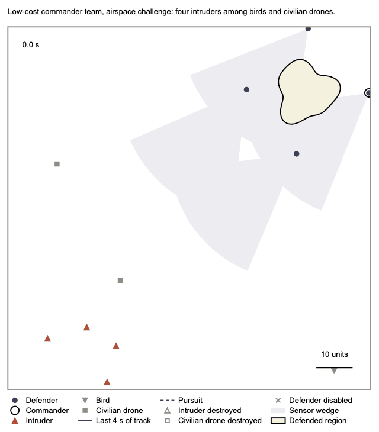

# Consensus Within, Competition Between: Decentralized LLM Teams for Perimeter Defense

Code for the paper *Consensus Within, Competition Between: Decentralized LLM Teams for Perimeter Defense*
(Khawaja Abaid Ullah, Ananya Acharya, Mohammad Javad Khojasteh; Rochester Institute of Technology).

A team of defenders protects a region against intruders in a simulated 2D arena. Every defender and every
intruder consults a large language model (LLM) once per decision epoch. The paper compares three ways of
allocating the defenders' tasks: a **commander** that assigns every task, a **consensus** team whose defenders
bid and settle conflicts with an auction (the consensus-based auction algorithm, CBAA), and **independent**
defenders that run the same agents without auction messages. It compares them under five network conditions,
varies how much authority the consensus team's LLM has over its bids, adds birds and civilian drones to the
airspace (with one photograph per contact), and tests intruders disguised as bird-shaped drones. This repository
holds the simulator, the LLM planners, the experiment runners and the replay viewer.

<p align="center">





</p>

*One illustrative episode each, eight times real time, drawn by the replay viewer (`viewer/`). Top row, the
consensus and commander teams on the ideal network (seed 4003); next, the independent team on the same seed, one
intruder still active at 40 s; then the commander team under limited range, where an order that never arrives is
dotted, and in the airspace challenge. Illustrations, not evidence: the rates are in the paper.*

## Install

Requires [conda](https://docs.conda.io/) and Python 3.11 (CasADi and OSQP for the motion controllers). `requirements-tested.txt` lists the exact versions the results were produced with; the replay viewer's still images, videos and GIFs also need Google Chrome (headless).

```bash
./setup_env.sh                  # creates the conda environment "multi_agent_mpc"
conda activate multi_agent_mpc
./smoke_test.sh                 # free end-to-end check: one short episode with rule planners, no network
python3 -m pytest               # the test suite (about 12 minutes on a laptop); no API key needed
python3 -m verification.verify_point_in_polygon   # the free geometry and mechanics checks: verification/verify_*.py
```

`--planner rule` and the `rule` backend run free, deterministic rule planners. They exist for the smoke test and
the tests; they are not a baseline and no result of the paper uses them.

## Run an experiment with an LLM

The six studies of the paper are defined in `experiments/studies.py`: `main_study`, `high_authority_low_cost`,
`high_authority_near_frontier`, `near_frontier_commander`, `airspace` and `disguise`. Running one calls paid models
through [OpenRouter](https://openrouter.ai) and **costs money**; a spend cap is required.

```bash
export OPENROUTER_API_KEY=...
python3 -m experiments.run airspace --data ./new_data --live --cap-usd 20
```

The low-cost model is Gemini 3.1 Flash-Lite and the near-frontier model is GPT-6.1 Sol; both profiles are in
`experiments/profiles.json`. Every model answer is stored under a hash of its full request, so a run that stops can
resume, and any episode can be replayed without a model.

## Reproduce the paper from the data deposit

The episode records, the cached model answers and the analysis outputs are not in this repository; they are in the
data deposit (**URL pending**). Unpack it anywhere and point `--data` at it; `data/README.md` describes the layout.

```bash
# Re-simulate every stored episode of a study from its cached answers. Free: no model is called,
# and a missing answer stops the episode instead of calling one.
python3 -m experiments.run main_study --data /path/to/deposit --replay
```

A re-simulated episode matches when it equals its stored record on the breach, the breach step, the breaching
intruder, every intruder's outcome, the number of intruders destroyed and the steps run.

The `disguise` study shows each intruder as a photograph of a bird-shaped drone. Those four photographs are not
published with this repository (no redistribution permission was recorded); supply your own directory with
`bird_drone_1.jpg` … `bird_drone_4.jpg` through `--bird-drone-dir`. A replay of the disguise runs needs
the original photographs, because the photograph bytes are part of every cached request
(`experiments/bird_drone_photos.sha256` lists their hashes). The other studies need only the licensed photographs
in `assets/contact_photos/`.

**Numbers and figures.** `analysis/` turns the deposited records into every number of the paper and of its Supplementary
Information, and `figures/` draws every figure from them:

```bash
python3 -m analysis.run_all --data /path/to/deposit --figures     # statistics, numbers.tex, si_numbers.tex, figures
```

The re-simulation measures (connectivity, time-limit endings, coverage, role counts, commitments and missed orders) take
about two hours; the deposit holds their outputs, and `--replays` recomputes them. `analysis/README.md` lists each script, its
input and its output; `figures/README.md` lists the figures. A fresh run reproduces the 365 macros of `numbers.tex` that are
read from the deposit, the 1,007 macros of `si_numbers.tex`, the Supplementary tables' rows, `Supplementary_Data_1.csv`, and the
figures of the paper pixel for pixel. Figure 7 also needs the four bird-drone photographs (`--bird-drone-dir`) and Google
Chrome; the Supplementary episode figures need Chrome.

**Supplementary files.** `supplementary/` holds Supplementary Data 1 (`Supplementary_Data_1.csv`, every paired comparison with
its per-seed values) and Supplementary Videos 1 to 3, the files the paper's Supplementary Information refers to.

## The replay viewer

`viewer/` draws any episode from a replay bundle: play, scrub and inspect it in a browser (open `viewer/index.html`),
or export a still, a vector figure panel, a video or a GIF from the same drawing code.

```bash
python3 -m scripts.replay_media gif --bundle episode.replay.js --speed 8 --fps 10 --width-px 640 \
    --title "Commander team, ideal network" --out episode.gif
```

`viewer/README.md` explains how to export a bundle from an episode and how to switch layers on and off. The
photograph layer is off in every figure and GIF here; it is available when exploring an episode.

## Names in the code and in the paper

| In the code | In the paper |
|---|---|
| `blue`, `red` | defenders, intruders |
| `cbaa` arm | consensus team (at low authority) |
| `cbaa_sw2` arm; strategy weights | consensus team at high authority (the LLM writes its own bid weights) |
| `commander`, `independent` arms | commander team, independent team |
| `REF`, `MH`, `LI`, `LB`, `REF+attack` | ideal network, limited range, independent loss, burst loss, falsified reports |
| `NEUTRALIZE`, `DEFEND`, `RECON` | pursue an intruder, hold a station, scout |
| `decoys` (record key), `birds`, `civilians` | birds and civilian drones |
| `image_mode` `img.1`, `img.1w` | the airspace prompt without and with the forewarning that intruders may be disguised |
| `camo-U-*`, `camo-W-*` runs | disguised intruders, without and with the forewarning |
| profile `low-cost`, `near-frontier` | Gemini 3.1 Flash-Lite, GPT-6.1 Sol |
| `m8b.7`, `m8b.9`, `commander.10`, `intruder.4`, `design-v2.3mb` | opaque version labels of the prompts and the design. They are part of every cached request, so they must not be changed |
| `touchdown` (record field) | a breach |

## Citation

Please cite the paper (see `CITATION.cff`). A DOI for this code is added to `CITATION.cff` when the release is archived.

## Licence

The code is released under the licence in `LICENSE`. The nine contact photographs in `assets/contact_photos/` are
third-party material under their own licences, listed in `assets/contact_photos/CREDITS.md`.

## Image credits

Each photograph, its author, its source page and its licence are in [`assets/contact_photos/CREDITS.md`](assets/contact_photos/CREDITS.md).
The nine photographs are the contacts of the airspace challenge: three intruder drones, three birds and three
civilian drones.
