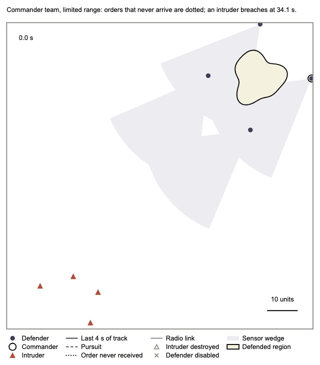

# Episode replay viewer

One tool for three jobs, all from the same drawing code (`js/scene.js`):

1. **Explore** an episode: play, scrub, step, jump to events, click an agent to see its task, its orders,
   what it sees and what it believes, and switch layers on and off.
2. **Stills and figures**: a PNG or SVG of any frame, or a multi-panel figure as a vector PDF in the paper's
   figure style (Arial 7 pt, strokes of at least 1 pt, the paper's colours).
3. **Videos and GIFs**: H.264 MP4 or GIF at any speed and over any frame range.

What you see in the browser is the exported drawing. The arena is `scene.panel` at the paper size of an exported
frame, enlarged to fit, and a still, a figure panel and a video frame are the same function's output printed or
captured by headless Chrome. There is no second renderer that could drift.



*An illustrative episode from the paper's study: the commander team under limited range (radio links in grey,
an order that never arrived dotted), eight times real time.*

No server, no build step, no network. Open `index.html` in a browser.

## 1. Export an episode

Episodes are deterministic in (seed, config), so the exporter re-runs one and writes a `pev-replay` bundle,
checked against the live episode before it is written (any mismatch raises):

```bash
# one episode, Exp 4 arm 2
PYTHONPATH=$PWD python3 -m scripts.export_replay --preset exp4 --arm 2 \
    --family symmetric --seed 3717 --out replays/sym_3717.replay.js

# two arms in one bundle -> side-by-side compare, synced timeline
PYTHONPATH=$PWD python3 -m scripts.export_replay --preset exp4 --arm 1 --arm 2 \
    --family multi_bearing --seed 3717 --out replays/pair_3717.replay.js
```

The command line uses the free rule planners and refuses seeds from 3725 up (pass `--allow-unspent-seed` only
if you mean to spend one). Any other episode, for example an LLM episode re-run from cached answers, exports
from Python the same way:

```python
from scripts import export_replay as er
capture = er.attach_capture(sim)          # read-only wrappers, before sim.run()
sim.run()
ep = er.episode_bundle(sim, capture, {"label": "...", "paper": {"team": "...", "condition": "..."}})
er.check_bundle(ep, sim, capture)         # raises if the bundle disagrees with the run
er.write_bundle(er.bundle_document([ep]), "x.replay.js")
```

Bundle format 2 adds, beside the recorder's per-step data:
- **Contacts:** birds and civilian drones (rows of the intruder state), the losses of birds and civilian drones, and the photograph each
  contact was shown as.
- **Radio links:** the link set of every communication round.
- **The commander's orders:** each with its fate. An order that "never arrived" is one its defender never applied
  that would have changed its task. Orders to a defender lost within one planning interval are excluded.
- **False beliefs (falsified reports only):** the believed positions that differ from the truth. Each is tied to
  a falsified record its holder accepted.

Format 1 bundles still open.

## 2. Open it and pick steps

* **Drop** a `.replay.js` (or `.replay.json`) file onto the page, or click **Open**. Dropping a second
  single-episode bundle opens compare mode.
* Or use the URL: `viewer/index.html?bundle=../replays/sym_3717.replay.js`. Repeat `bundle=` to compare
  two. From `file://`, use the `.replay.js` form, because browsers refuse `fetch` of local `.json`.

URL extras: `f=<step>`, `select=b2|r0` (defender D3, intruder I1), `play=1`,
`layers=links:1,orders:1,labels:0`.

To pick steps for a figure, scrub or jump between events (`e` / `E`); the clock shows the step. The last step
is drawn with the episode's stored outcome (it comes before that step's resolution), and times are step × 0.1 s,
as the paper reports them (a breach "at 34.1 s").

Keys: `space` play · `←/→` step (shift = 10) · `[ ]` speed · `e / E` events · `1–9` select a defender ·
`c` wedges · `r` tracks · `b` beliefs · `g` never swept · `l` labels · `n` radio links and orders · `p` photographs ·
`f` fit · `s` still · `v` video · `?`.

## 3. Export a still, an SI figure, a video or a GIF

In the browser: **Still** (PNG), **SVG** (vector) and **Video** (in-browser recording, MP4 or WebM) save the
current frame or play out from it, with the layers you have on. For publication files use the driver, which
captures the same drawing in headless Chrome (needs Chrome or Chromium and, for video, ffmpeg):

```bash
# a figure: one panel per step, a heading each, one key (vector PDF + 300 dpi PNG preview)
python3 -m scripts.replay_media figure --bundle x.replay.js --steps 208,260,311,341 \
    --headings "All four intruders seen|Order not received|Orders still not received|Breach" \
    --layers links:1,orders:1 --out fig.pdf

# a still (PNG at any width, or .svg)
python3 -m scripts.replay_media still --bundle x.replay.js --frame 260 --width-px 1600 --out s.png

# a video: speed in times real time, any frame range, last frame held
python3 -m scripts.replay_media video --bundle x.replay.js --speed 4 --fps 20 --width-px 1080 \
    --title "Commander team · limited range · seed 4001" --out v.mp4

# a GIF for a README
python3 -m scripts.replay_media gif --bundle x.replay.js --speed 8 --fps 10 --width-px 560 --out v.gif
```

`--start` / `--end` pick the frame range, and `--layers` turns any layer on or off (see `scene.FIGURE_LAYERS`).
A figure is 180 mm wide by default (`--width-mm` 88 or 120 for narrower ones), and its PDF embeds Arial as
TrueType.

## What you are looking at

| | |
|---|---|
| filled circle | defender (D1, D2, … with labels on) |
| black ring | the commander: whoever planned the newest epoch |
| filled triangle | intruder (I1, I2, …) |
| grey downward triangle / grey square | bird / civilian drone |
| hollow grey triangle or square | an intruder or civilian drone destroyed; grey cross, a defender disabled |
| shaded wedge | a defender's sensor, at the configured half-angle and range |
| solid line | the last 4 s of each track |
| dashed line | a pursuit: the contact the defender's controller is steered at |
| grey line | a radio link of the latest communication round |
| dotted black line | an order that never arrived and would have changed the defender's task |
| hollow triangle on a dotted line | a false belief from a falsified report |
| shaded shape | the defended region |

The inspector's key is the scene's own key. Explore-only layers: labels, the team's freshest beliefs with their
age, other tasks (screen, station, scouting), sight lines, never-swept ground, safety-filter pushes, and the
photographs.

The timeline shows one ribbon per defender (pattern = task, notches = assigned ≠ executed, underline = its own
sensor holds a contact), one lane per contact, the safety-filter track and the events.

## Not shown, because it is not recorded

Bids, auction messages and per-message losses; which safety-filter constraint was active (the slack rows are
unlabelled); the pursuit controller's internal aim state; unassigned scouting points; MPC plans.

## Checks

* `tests/test_export_replay.py`: bundles reproduce the golden fingerprints, the wrappers are inert, belief,
  coverage and kill derivations are exact. Rows and losses of birds and civilian drones export, each link round is the disk rule on the
  recorded positions, order fates follow the definition, and false beliefs are shipped only when tied to an
  accepted falsified record.
* `tests/test_replay_scene.py`: the scene writes only the paper's colours, 7 pt Arial and strokes of at least
  1 pt, and the driver prints a one-page PDF with embedded TrueType Arial.
* `python3 -m verification.verify_replay_viewer`: headless Chrome renders sampled steps. The centres and sensor
  wedges written into the SVG must match the recorder, and every recorded detection must lie inside its drawn
  wedge.
* `index.html?bundle=…&selftest=export` / `selftest=perf`: in-page still, SVG and video export, and per-part
  draw timings, written to `#probe-out`.
